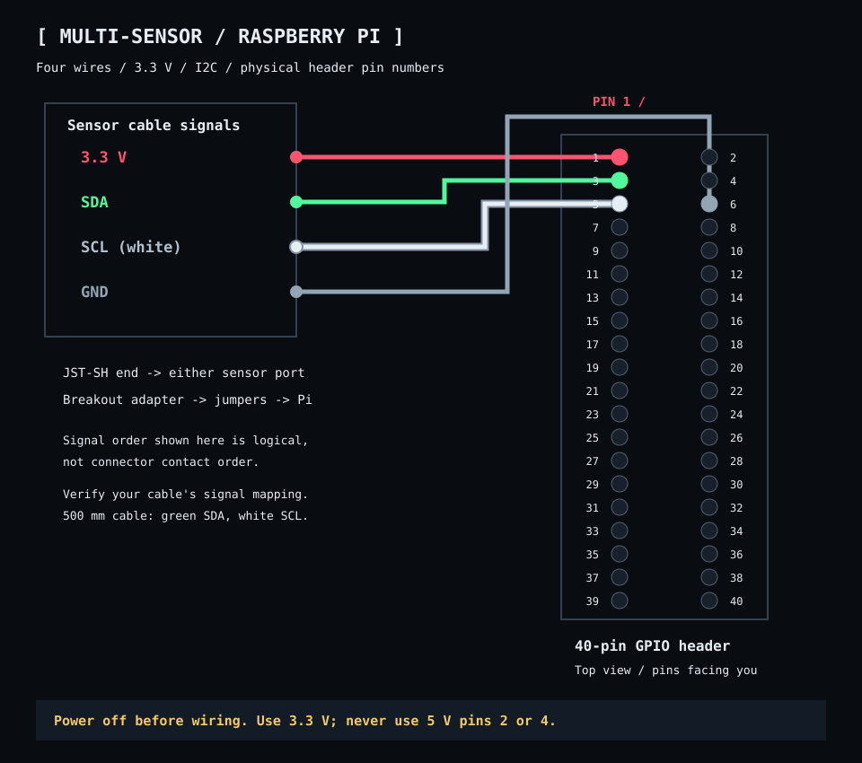

# Sensor and indicator LED wiring

For a Raspberry Pi with a standard 40-pin GPIO header. **Shut down the Pi and disconnect power before wiring.** All pin numbers below are physical header positions; GPIO18 is the software name for physical pin 12.

## Optional blinking LED


| Physical pin | Function | Connection |
|---|---|---|
| 12 | GPIO18: 3.3 V HIGH / 0 V LOW | Through a 470 Ω resistor to LED anode (+, long leg) |
| 9 | Ground: 0 V | LED cathode (−, short leg / flat side) |

Use a small indicator LED with a forward voltage below 3.3 V and a series resistor. The LED’s actual forward voltage depends on its model; the 470 Ω resistor drops the remaining voltage and limits current. These pins are free with the sensor wiring below. A lamp or LED strip requires a separate transistor driver; do not connect it directly to GPIO. Locate pin 1 using the board marking before counting header pins.

**Pin change:** move only the resistor-side wire from physical pin **11 / GPIO17** to physical pin **12 / GPIO18**. Keep ground on **pin 9**, the **470 Ω resistor**, and the LED polarity unchanged. GPIO18 supports hardware PWM on this Raspberry Pi 5.

The client drives GPIO18 with **2 kHz hardware PWM**, using RP1 PWM0 channel 2 on this Raspberry Pi 5. On startup it finds the `1f00098000.pwm` controller under `/sys/class/pwm`, exports channel 2, and selects GPIO18 alternate function `a3` with `/usr/bin/pinctrl`. Pulse generation runs in hardware, independent of Python and frame delivery. Shutdown sets duty to zero, leaving a constant-low output.

The desktop user needs membership in the `gpio` group, write access to the PWM sysfs files, and access to the GPIO memory device used by `pinctrl`. The current Raspberry Pi OS provides these permissions. The PWM0 controller must be enabled. The controller at `1f0009c000.pwm` is PWM1 and cannot drive GPIO18; the client rejects it. Enable PWM0 once, from the project directory:

```bash
sudo sh scripts/setup-hardware-pwm.sh
make restart
```

The [setup script](../scripts/setup-hardware-pwm.sh) loads the `pwm` overlay immediately and adds `dtoverlay=pwm,pin=18,func=2` under `[all]` in `/boot/firmware/config.txt` for future boots, saving a backup before changing that file. No reboot is needed when the live overlay loads successfully. This mapping is specific to the Raspberry Pi 5; other models need a different channel and pin function.

In circle mode: with neither sensor triggered, an eight-second pulse between 2% and 25% brightness, never fully off. Idle rises and falls each use a smooth four-second curve. When either sensor triggers, the LED fades from its current brightness to fully off over two seconds (twice as fast as an idle fade) and stays off while a sensor remains active. When both clear, it rises smoothly toward 25% over four seconds, then resumes the idle pulse.

## Pimoroni Multi-Sensor Stick



See the [complete sensor wiring guide](multisensor-raspberry-pi-wiring.md) for cable colours, adapters, and I²C checks.

Connect the PIM745 through a Qwiic/STEMMA QT breakout adapter and female jumper wires. A JST-SH cable cannot plug directly onto the Pi header. Verify signals against the cable supplier’s pinout rather than relying only on wire colour.

| Sensor signal | Pi physical pin | Pi function |
|---|---|---|
| 3.3 V | 1 | 3.3 V power |
| Ground | 6 | Ground |
| SDA | 3 | GPIO2 / I²C data |
| SCL | 5 | GPIO3 / I²C clock |

Do not connect sensor power to 5 V pins 2 or 4. Expected I²C addresses are `0x23` (LTR559 light/proximity), `0x6a` (LSM6DS3-family accelerometer/gyroscope), and `0x76` (BME280 temperature/humidity/pressure).

See [setup](setup.md#foreground-and-controls) for I²C access, calibration, and sensor response settings.

## References

- [Raspberry Pi GPIO documentation](https://www.raspberrypi.com/documentation/computers/raspberry-pi.html)
- [Raspberry Pi physical computing guide](https://projects.raspberrypi.org/en/projects/physical-computing)
- [Pimoroni Multi-Sensor Stick](https://shop.pimoroni.com/products/multi-sensor-stick)

[Wiki index](index.md)
