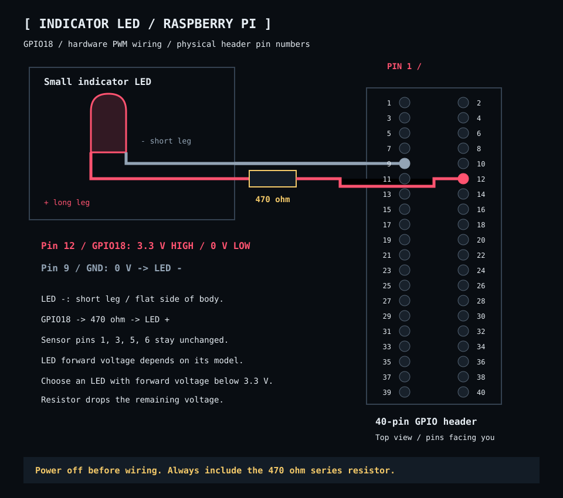

# Indicator LED

For a Raspberry Pi with a standard 40-pin GPIO header. All pin numbers below are physical header positions; GPIO18 is the software name for physical pin 12. **Shut down the Pi and disconnect power before wiring.**




| Physical pin | Function | Connection |
|---|---|---|
| 12 | GPIO18: 3.3 V HIGH / 0 V LOW | Through a 470 Ω resistor to LED anode (+, long leg) |
| 9 | Ground: 0 V | LED cathode (−, short leg / flat side) |

Use a small indicator LED with a forward voltage below 3.3 V and a series resistor. The LED’s actual forward voltage depends on its model; the 470 Ω resistor drops the remaining voltage and limits current. These pins are free with the sensor wiring below. A lamp or LED strip requires a separate transistor driver; do not connect it directly to GPIO. Locate pin 1 using the board marking before counting header pins.

**Pin change:** move only the resistor-side wire from physical pin **11 / GPIO17** to physical pin **12 / GPIO18**. Keep ground on **pin 9**, the **470 Ω resistor**, and the LED polarity unchanged. GPIO18 supports hardware PWM on this Raspberry Pi 5.

The client drives GPIO18 with **2 kHz hardware PWM**, using RP1 PWM0 channel 2 on this Raspberry Pi 5. On startup it finds the `1f00098000.pwm` controller under `/sys/class/pwm`, exports channel 2, and selects GPIO18 alternate function `a3` with `/usr/bin/pinctrl`. Pulse generation runs in hardware, independent of Python and frame delivery. Shutdown sets duty to zero, leaving a constant-low output.

The desktop user needs membership in the `gpio` group, write access to the PWM sysfs files, and access to the GPIO memory device used by `pinctrl`. The current Raspberry Pi OS provides these permissions. The PWM0 controller must be enabled. The controller at `1f0009c000.pwm` is PWM1 and cannot drive GPIO18; the client rejects it. Enable PWM0 once, from the project directory:

```bash
sudo sh scripts/setup-hardware-pwm.sh
make restart
```

The [setup script](../../scripts/setup-hardware-pwm.sh) loads the `pwm` overlay immediately and adds `dtoverlay=pwm,pin=18,func=2` under `[all]` in `/boot/firmware/config.txt` for future boots, saving a backup before changing that file. No reboot is needed when the live overlay loads successfully. This mapping is specific to the Raspberry Pi 5; other models need a different channel and pin function.

In hexapod circle mode, brightness is proportional to the living population reported by the server: `25% × alive / configured count`. Full population gives 25% brightness, half gives 12.5%, and zero turns the LED off. Sensor activation does not start a timed fade. Deaths reduce brightness and replacement births restore it. Living counts use simulation mass above 0.001, including living organisms outside the visible circle. Catalog circle simulations retain the eight-second idle pulse between 2% and 25% and the two-second sensor fade.

[Section index](index.md) · [Wiki index](../index.md)
